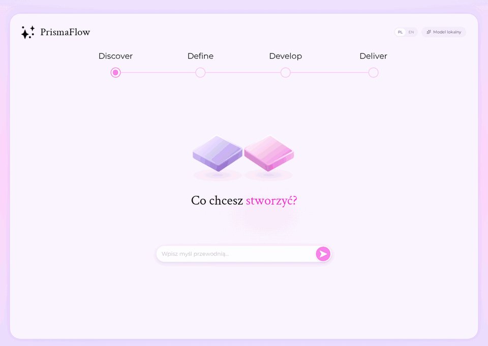
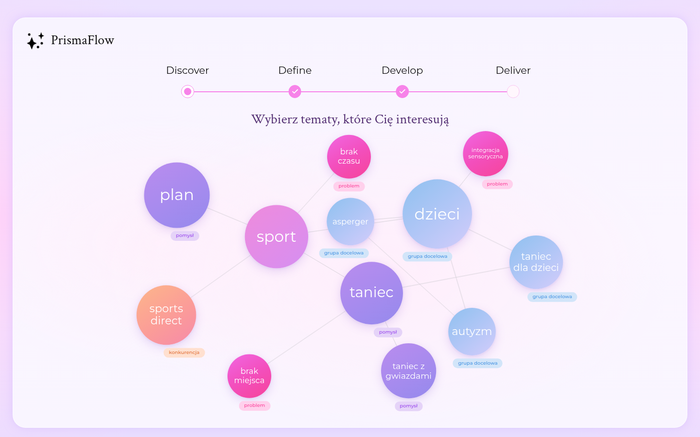
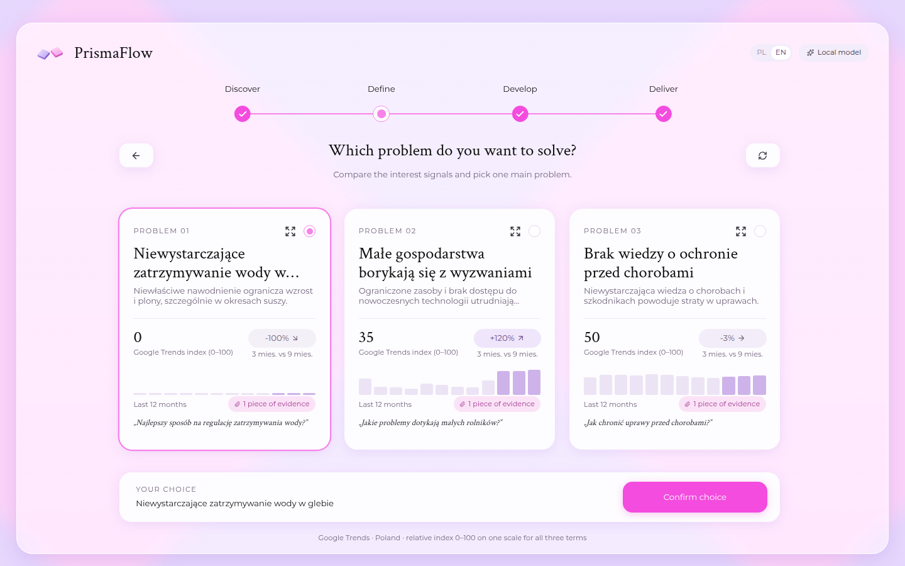

# PrismaFlow

Local-first desktop studio for discovering product niches with the Double Diamond method
(Discover → Define → Validate → Develop → Deliver). Everything runs on your machine: a FastAPI backend,
a SQLite workspace with FTS5, market-data collectors and a local LLM served by Ollama,
displayed in a native window through pywebview (WebKitGTK on Linux, WebView2 on Windows).
The interface is available in Polish and English.

## Install

Download the Windows installer or Linux build, including the current beta, from the [PrismaFlow download page](https://praha6248.github.io/PrismaFlow/).

| System | File |
| --- | --- |
| Windows 10/11 (x64) | `PrismaFlow-<version>-windows-x64-setup.exe` |
| Linux (x86_64, glibc 2.39+) | `PrismaFlow-<version>-x86_64.AppImage` or `PrismaFlow-linux-x86_64.tar.gz` |

Or install with one command:

```bash
curl -fsSL https://raw.githubusercontent.com/praha6248/PrismaFlow/main/install.sh | sh
```

```powershell
irm https://raw.githubusercontent.com/praha6248/PrismaFlow/main/install.ps1 | iex
```

The Linux script unpacks the latest build to `~/.local/share/PrismaFlow-app`, links `prismaflow` into
`~/.local/bin` and adds a menu entry. The window needs WebKit2GTK (`sudo apt install gir1.2-webkit2-4.1 python3-gi`);
the AppImage also needs FUSE 2 (`libfuse2t64`). The Windows script downloads and runs the setup wizard.

### Run with Docker Compose

From the repository root, start PrismaFlow and Ollama, then download a model once.

```bash
docker compose up -d --build
docker compose exec ollama ollama pull gemma3:4b
```

Open <http://127.0.0.1:8765>. To enable semantic evidence search, also run
`docker compose exec ollama ollama pull bge-m3`. Compose stores projects and settings
in the `workspace` volume and downloaded models in `models`. Both survive `docker compose down`.

## Models

PrismaFlow writes text with a local model in [Ollama](https://ollama.com/download). On first launch it checks
Ollama, picks the model that fits your RAM and shows the command for anything missing.

| Model | Size | Purpose | Command |
| --- | --- | --- | --- |
| [Gemma 3 12B](https://ollama.com/library/gemma3) | 8.1 GB | all phases, 16 GB RAM or more | `ollama pull gemma3:12b` |
| [Gemma 3 4B](https://ollama.com/library/gemma3) | 3.3 GB | all phases, less than 16 GB RAM | `ollama pull gemma3:4b` |
| [BGE-M3](https://ollama.com/library/bge-m3) | 1.2 GB | optional, semantic evidence search | `ollama pull bge-m3` |
| PrismaFlow UX (Gemma 3 4B fine-tune) | 3.3 GB | optional, better flows and fixes in Deliver | see [UX fine-tune](#ux-fine-tune-for-deliver) |

Without local models you can turn on the **quality mode** (top-right button) with your own Anthropic API key:
problems, personas, the backlog and flows are then written by Claude, still citing the collected evidence,
and the app falls back to Ollama when Claude is unavailable. Prompts, including the collected discussions,
are sent to Anthropic in this mode. The key is stored only in the local settings file with mode 600.

## Screenshots



| Discover | Define |
| --- | --- |
|  |  |
| **Develop** | **Deliver** |
|  |  |

## Use it in a browser (no WebKit needed)

The desktop window is optional. The backend serves the full UI over HTTP, so on any system with Python 3.11+,
Node.js 20+ and Ollama you can run from source:

```bash
python -m venv .venv && .venv/bin/pip install -r requirements.txt
cd frontend && npm install && npm run build && cd ..
.venv/bin/python main.py --server-only --port 8765
```

Then open <http://127.0.0.1:8765> in your browser. Only the desktop window needs WebKit2GTK and PyGObject.

## Building from source

### Requirements

- Linux with WebKit2GTK 4.1 and PyGObject (`gir1.2-webkit2-4.1`, `python3-gi`), or Windows 10/11 with WebView2
- Python 3.11+
- Node.js 20+ (only to build the frontend)
- Ollama with an instruction model; `gemma3:12b` works best, smaller models are picked automatically

### Setup

```bash
uv venv .venv --python /usr/bin/python3 --system-site-packages
uv pip install -r requirements-dev.txt
.venv/bin/python -m playwright install --only-shell chromium
cd frontend && npm install && npm run build && cd ..
.venv/bin/python main.py
```

`--system-site-packages` lets the virtualenv reuse the distribution's PyGObject. On Windows a plain
virtualenv is enough.

### Development

```bash
.venv/bin/python main.py --server-only --port 8765
cd frontend && npm run dev
.venv/bin/python main.py --dev http://localhost:5173
.venv/bin/python -m pytest
```

### UX fine-tune for Deliver

`training/` holds a LoRA fine-tune of Gemma 3 4B for the Deliver phase. It is trained on audit-driven
flow fixes and flow drafts generated from the app's own prompts and audit, plus UX/UI knowledge distilled
from WCAG 2.2, the GOV.UK Design System, MDN and Wikipedia. When `local/gemma3-4b-ux` is installed in
Ollama, the flow generation and audit suggestions use it (`TASK_MODELS` in `backend/config.py`). The
other phases keep the general model, and `PRISMAFLOW_MODEL` overrides both. On held-out niches it cuts
audit issues by 68%, against 34% for the base 4B and 42% for `gemma3:12b`, at about a third of the 12B's
latency. Results, caveats and reproduction steps are in [training/REPORT.md](training/REPORT.md); the
sources are in [docs/bibliography.md](docs/bibliography.md). Once the GGUF is published on Hugging Face,
set `PRISMAFLOW_UX_MODEL_REPO` (and the `UX_MODEL_REPO` repository variable for release notes) so the
first-run guide shows the download command:

```bash
ollama pull hf.co/<user>/<repo> && ollama cp hf.co/<user>/<repo> local/gemma3-4b-ux
```

### Translations

UI strings are written in Polish in the source and wrapped in `t("…")` from `frontend/src/i18n.ts`.
`frontend/src/locales/en.json` maps each Polish string to English; plural forms use the key
`one|few|many` and the value `singular|plural`. To add a language, add a catalog next to `en.json`,
register it in `CATALOGS` and add its code to the switch in `components/QualitySettings.tsx`. Missing
entries fall back to Polish. The language of generated content follows `PRISMAFLOW_LOCALE` (or the
system locale), independently of the interface language.

## Configuration

Environment variables, or `KEY=value` lines in `~/.config/PrismaFlow/prismaflow.env`
(`%APPDATA%\PrismaFlow\prismaflow.env` on Windows):

| Variable | Purpose |
| --- | --- |
| `OLLAMA_HOST` | Ollama address, e.g. `127.0.0.1:11434` |
| `PRISMAFLOW_MODEL` | Force a specific Ollama model |
| `PRISMAFLOW_EMBED_MODEL` | Ollama embedding model for semantic evidence retrieval (default `bge-m3`; without it retrieval falls back to full-text and graph neighbours) |
| `PRISMAFLOW_LOCALE` | Default content locale, e.g. `pl_PL` or `en_US` |
| `PRISMAFLOW_TREND_ANCHOR` | Google Trends calibration keyword |
| `PRISMAFLOW_REDDIT_CLIENT_ID` / `PRISMAFLOW_REDDIT_CLIENT_SECRET` | Optional Reddit OAuth app credentials |
| `PRISMAFLOW_REDDIT_PLAYWRIGHT` | Set to `1` to prefer Chromium even when OAuth credentials are configured |
| `PRISMAFLOW_DISCUSSION_MAX_AGE_DAYS` | Oldest community discussion still used as evidence, in days (default 1095, three years) |
| `PRISMAFLOW_ANTHROPIC_API_KEY` | Your Anthropic API key for the quality mode (set from the app, never shown again) |
| `PRISMAFLOW_QUALITY_MODE` | `1` to write with Claude instead of Ollama |
| `PRISMAFLOW_UX_MODEL_REPO` | Hugging Face repository of the UX fine-tune, shown in the first-run guide |
| `PRISMAFLOW_DATA_DIR` | Workspace location (default `~/.local/share/PrismaFlow`, `%LOCALAPPDATA%\PrismaFlow` on Windows) |

Community evidence comes from two documented, keyless public APIs: Stack Exchange questions
(sites such as fitness, parenting or cooking are picked from the query's topic; about 300 requests
per day per IP, cached for three days) and Lemmy, a federated Reddit-like forum, searched through
lemmy.world.

Reddit is **disabled by default**. To enable it, create a Reddit API app and set
`PRISMAFLOW_REDDIT_CLIENT_ID` and `PRISMAFLOW_REDDIT_CLIENT_SECRET` (OAuth). Browser scraping with
Playwright is an explicit opt-in (`PRISMAFLOW_REDDIT_PLAYWRIGHT=1`) and requires
[Reddit's written permission](https://redditinc.com/policies/user-agreement); you are responsible
for complying with it. Discover caches the results and continues with its other sources if Reddit is
unavailable.

## Phases

- **Discover** — mind map grown by the local model from Google Autocomplete, with Google Trends and community
  evidence attached to every node.
- **Define** — three problem statements grounded in the starred topics, compared on one Google Trends scale,
  and proto-personas for the chosen problem. Every problem and persona cites the evidence it is based on;
  the ones without evidence are marked as hypotheses to check.
- **Validate** — 3–5 hypotheses (the problem exists, how often it happens, the current workaround,
  money or time already spent), screening questions and a Mom Test interview script. Paste interview notes
  and the model scores each hypothesis, but a verdict only counts with a verbatim quote from the notes.
  A hypothesis is confirmed after three supporting interviews; confirmed findings feed Develop and the handoff.
- **Develop** — a MoSCoW backlog for the chosen persona; demand is the share of collected evidence
  (Google suggestions, Stack Exchange and Lemmy discussions) that supports a feature.
- **Deliver** — user flow studio with a live UX audit computed with NetworkX:
  steps to goal (shortest path), KLM time to goal (M = 1.35 s plus Hick and Fitts per step),
  Hick decision time `RT = a + b·log2(n+1)` (a = 0.25 s, b = 0.15 s), Fitts difficulty `ID = log2(2D/W)`
  from target size and thumb zone, WCAG 2.2 touch target sizes (24 px AA, 44 px AAA), dead ends and
  unreachable screens. Hick is counted per decision: every list, filter and choice between actions.
  The panel leads with a plain-language list of what to fix, each item jumping to its screen, and keeps
  the raw metrics behind "Measurement details". The model proposes fixes that can be accepted in one click,
  and "Generate handoff" writes `figma-prompt.md` and `CLAUDE.md` (with UX/UI guidelines, a visual style
  chosen for the product and the validated findings) to `~/Documents/PrismaFlow/<project>/`. "New problem"
  starts the next round.

Evidence is collected bilingually: queries are translated to English by the local model, English
suggestions and threads are fetched alongside local ones and translated back into the project
language, keeping the original text in the evidence metadata.

## Design

The interface uses a frosted-glass card over a blurred double-diamond background, Crimson Text for titles
and Montserrat for everything else. Text uses three sizes only (`--text-small`, `--text-body` and
`--text-title` in `frontend/src/index.css`, 12, 14 and 28 px at the default window size); the screen
mock-ups on the Deliver canvas and the mind-map bubbles scale with zoom and bubble size. Colours are
tokens in the same file and every text colour meets WCAG 2.2 AA contrast (4.5:1) against the card and
tinted backgrounds. Body text is near-black, the brand pink `#f783e9` is used for accents, and
buttons with white semibold labels use the deeper `#f34cdf`.

## Contributing

Contributions are welcome, see [CONTRIBUTING.md](CONTRIBUTING.md) and the
[good first issues](docs/good-first-issues.md). PrismaFlow is validated the way it asks its users to
validate: [docs/validation-plan.md](docs/validation-plan.md) holds the hypotheses, recruitment plan
and interview script.

## License

PrismaFlow is released under the [GNU Affero General Public License v3.0](LICENSE). If you run a
modified version as a network service, you must offer its source code to the users of that service.

## Packaging

```bash
cd frontend && npm run build && cd ..
PLAYWRIGHT_BROWSERS_PATH=0 .venv/bin/python -m playwright install --only-shell chromium
cd packaging && ../.venv/bin/pyinstaller --noconfirm --distpath ../dist --workpath ../build prismaflow.spec
./dist/PrismaFlow/prismaflow
```

## CI/CD

- `.github/workflows/ci.yml` runs on every push to `main` and on pull requests: backend tests (`pytest`) and the frontend type check and build.
- `.github/workflows/release.yml` runs on a `v*` tag (or by hand): it builds the frontend, runs the tests and packages the app with PyInstaller on Ubuntu 24.04 (tarball and AppImage) and Windows Server 2022 (Inno Setup wizard with a page on where to get the models). On a tag it publishes a GitHub release with all three files and the notes from `packaging/release-notes.md`.

```bash
git tag v0.1.0 && git push origin v0.1.0
```

## Layout

```
main.py                  desktop entry point (pywebview + background Uvicorn)
install.sh, install.ps1  one-command installers for Linux and Windows
backend/config.py        settings, paths, locale
backend/database.py      SQLite schema and data access
backend/collectors/      Google Autocomplete, Google Trends, Stack Exchange, Lemmy and Reddit
backend/ollama_client.py structured outputs validated by Pydantic
backend/claude_client.py optional quality mode with Claude and fallback to Ollama
backend/services/        Discover, Define, Validate, Develop and Deliver services, first-run checks, translation, jobs
backend/api.py           HTTP API and static frontend
frontend/                React + React Flow UI, translations in frontend/src/locales/
packaging/               PyInstaller spec, icon, Inno Setup script, AppImage files, release notes
docs/mockups/            reference designs
```
