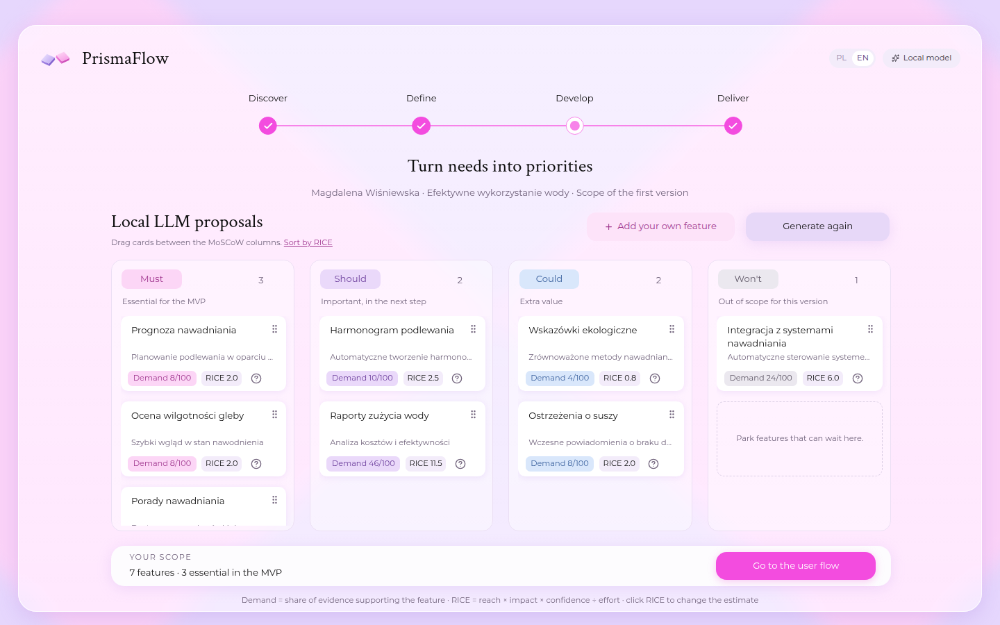
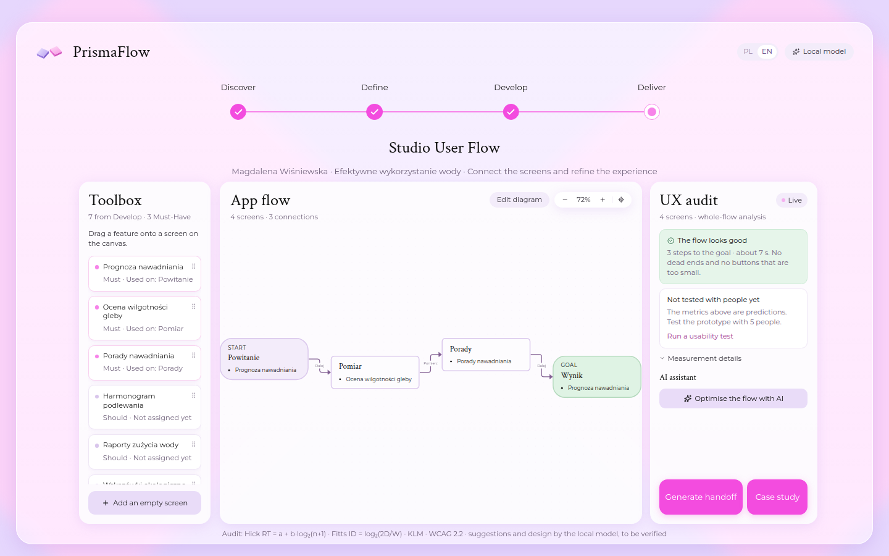

# PrismaFlow

A local-first desktop app that helps you find and validate a product idea, from a rough topic to a
user flow you can hand to a designer. It follows the Double Diamond method (Discover, Define, Validate,
Develop, Deliver) and runs entirely on your machine: no account, no cloud, your data stays local.


## Features

- **Discover** – a mind map of related topics grown from Google Autocomplete, with Google Trends and
  community discussions (Stack Exchange, Lemmy, optional Reddit, YouTube and RSS) attached to every node.
- **Affinity board** – forum threads from Discover, your own notes and interview fragments on one
  board. The model groups them into themes, you move notes between themes and rename them, and the
  themes become the input for the problem statements.
- **Define** – three problem statements and proto-personas, each citing the evidence it is based on.
  When notes from real people exist, a persona's quote is copied from them and marked as such; other
  quotes are marked as written by the model.
- **Validate** – testable hypotheses, screening questions and a Mom Test interview script. Paste
  interview notes and the model scores each hypothesis, counting a verdict only when it comes with a
  verbatim quote. Interview notes also land on the affinity board.
- **Empathy map and journey** – what the persona says, thinks, does and feels, and a before / during /
  after journey with an emotion curve and pain points. Each item links to the note it came from;
  unlinked items are shown as model inferences. Three "How might we…?" questions follow from the
  pain points, and the one you pick frames Develop.
- **Develop** – a MoSCoW backlog that answers the chosen "How might we" question, with demand measured
  as the share of collected evidence supporting each feature and a RICE score (reach from evidence,
  confidence from evidence and confirmed interviews, impact and effort you can adjust).
- **Deliver** – a user flow editor with a live UX audit: steps to goal, KLM time estimate, Hick's law,
  Fitts's law, WCAG 2.2 touch target sizes, dead ends and unreachable screens.
- **Usability tests** – tasks written for every goal screen, a clickable prototype that records each
  participant's path and time, and results compared with the KLM prediction (success rate, slow tasks,
  where people left the shortest path). Any observation or quote can go back to the Define board as a
  note or to the Develop backlog as a feature.
- **UX case study** – a portfolio-style case study written from the project's own data, in the section
  order used by public UX case studies. Numbers, quotes and lists are copied from the project, the local
  model only writes short narrative, sentences with numbers that are not in the data are dropped, and
  missing facts are marked as gaps. Exported as `case-study.md`, `case-study.html` and `case-study.pdf`.
- **Handoff** – `figma-prompt.md`, `CLAUDE.md`, a research report (`raport.md`, `raport.html` and
  `raport.pdf` when Chromium is available) and `prototyp-figma.svg`, which Figma imports as editable
  layers, saved to `~/Documents/PrismaFlow/<project>/`.

Text is generated by a local model through [Ollama](https://ollama.com). An optional quality mode uses
your own Anthropic API key instead and falls back to Ollama when Claude is unavailable. The interface
is available in Polish and English.

## Screenshots

| Discover | Define |
| --- | --- |
|  |  |
| **Develop** | **Deliver** |
|  |  |

## Tech stack

- **Backend:** Python 3.11, FastAPI, SQLite with FTS5, Pydantic, NetworkX
- **Frontend:** React, TypeScript, React Flow, Vite
- **AI:** Ollama (Gemma 3, BGE-M3 embeddings), optional Anthropic API, a LoRA fine-tune for UX flows
- **Desktop:** pywebview (WebKitGTK on Linux, WebView2 on Windows), PyInstaller, Inno Setup, AppImage
- **Tooling:** pytest, GitHub Actions (tests, build, release), Docker Compose

## Getting started

### Install

Download the Windows installer or the Linux build from the
[download page](https://praha6248.github.io/PrismaFlow/), or use a one-line installer:

```bash
curl -fsSL https://raw.githubusercontent.com/praha6248/PrismaFlow/main/install.sh | sh
```

```powershell
irm https://raw.githubusercontent.com/praha6248/PrismaFlow/main/install.ps1 | iex
```

On Linux the window needs WebKit2GTK (`sudo apt install gir1.2-webkit2-4.1 python3-gi`), and the
AppImage needs FUSE 2 (`libfuse2t64`).

### Models

Install [Ollama](https://ollama.com/download), then pull a model. On first launch PrismaFlow checks
Ollama and shows the command for anything missing.

```bash
ollama pull gemma3:12b
ollama pull bge-m3
```

Use `gemma3:4b` on machines with less than 16 GB of RAM. `bge-m3` is optional and enables semantic
evidence search.

### Run with Docker Compose

```bash
docker compose up -d --build
docker compose exec ollama ollama pull gemma3:4b
```

Then open <http://127.0.0.1:8765>.

### Run from source

Requires Python 3.11+, Node.js 20+ and Ollama.

```bash
python -m venv .venv && .venv/bin/pip install -r requirements.txt
cd frontend && npm install && npm run build && cd ..
.venv/bin/python main.py --server-only --port 8765
```

Open <http://127.0.0.1:8765> in a browser. To use the desktop window instead, drop `--server-only`
(Linux needs WebKit2GTK and PyGObject, Windows needs WebView2).

## Development

```bash
.venv/bin/python main.py --server-only --port 8765
cd frontend && npm run dev
.venv/bin/python main.py --dev http://localhost:5173
.venv/bin/python -m pytest
```

Contributions are welcome, see [CONTRIBUTING.md](CONTRIBUTING.md) and the
[good first issues](docs/good-first-issues.md).

## Configuration

Set environment variables, or `KEY=value` lines in `~/.config/PrismaFlow/prismaflow.env`
(`%APPDATA%\PrismaFlow\prismaflow.env` on Windows). The most useful ones:

| Variable | Purpose |
| --- | --- |
| `OLLAMA_HOST` | Ollama address, e.g. `127.0.0.1:11434` |
| `PRISMAFLOW_MODEL` | Force a specific Ollama model |
| `PRISMAFLOW_EMBED_MODEL` | Embedding model for semantic evidence search (default `bge-m3`) |
| `PRISMAFLOW_LOCALE` | Default content locale, e.g. `pl_PL` or `en_US` |
| `PRISMAFLOW_RSS_FEEDS_PL` / `PRISMAFLOW_RSS_FEEDS_EN` | Forum RSS/Atom feeds for your niche |
| `PRISMAFLOW_YOUTUBE_API_KEY` | Optional YouTube Data API v3 key for video comments |
| `PRISMAFLOW_REDDIT_CLIENT_ID` / `PRISMAFLOW_REDDIT_CLIENT_SECRET` | Optional Reddit OAuth credentials |
| `PRISMAFLOW_QUALITY_MODE` | `1` to write with Claude instead of Ollama |
| `PRISMAFLOW_DATA_DIR` | Workspace location (default `~/.local/share/PrismaFlow`) |

Reddit is disabled by default. Browser scraping is an explicit opt-in (`PRISMAFLOW_REDDIT_PLAYWRIGHT=1`)
and requires [Reddit's written permission](https://redditinc.com/policies/user-agreement). Discover
continues with its other sources when a source is unavailable.

## UX fine-tune

`training/` holds a LoRA fine-tune of Gemma 3 4B for the Deliver phase, trained on audit-driven flow
fixes and UX/UI knowledge from WCAG 2.2, the GOV.UK Design System and MDN. On held-out niches it cuts
audit issues by 68%, against 34% for the base 4B and 42% for `gemma3:12b`, at about a third of the 12B's
latency. Method, caveats and reproduction steps are in [training/REPORT.md](training/REPORT.md); sources
are in [docs/bibliography.md](docs/bibliography.md).

## Project structure

```
main.py                  desktop entry point (pywebview + background Uvicorn)
backend/api.py           HTTP API and static frontend
backend/database.py      SQLite schema and data access
backend/collectors/      Google Autocomplete and Trends, Stack Exchange, Lemmy, Reddit
backend/services/        Discover, Define, Validate, Develop and Deliver services
backend/ollama_client.py structured outputs validated by Pydantic
backend/claude_client.py optional quality mode with fallback to Ollama
frontend/                React + React Flow UI, translations in frontend/src/locales/
training/                UX fine-tune scripts and report
packaging/               PyInstaller spec, Inno Setup script, AppImage files
tests/                   backend tests
```

## Packaging and releases

```bash
cd frontend && npm run build && cd ..
cd packaging && ../.venv/bin/pyinstaller --noconfirm --distpath ../dist --workpath ../build prismaflow.spec
```

CI (`.github/workflows/ci.yml`) runs the backend tests and the frontend type check and build on every
push and pull request. Pushing a `v*` tag runs `release.yml`, which builds the Linux tarball and AppImage
and the Windows installer and attaches them to a GitHub release.

## License

Released under the [GNU Affero General Public License v3.0](LICENSE).
